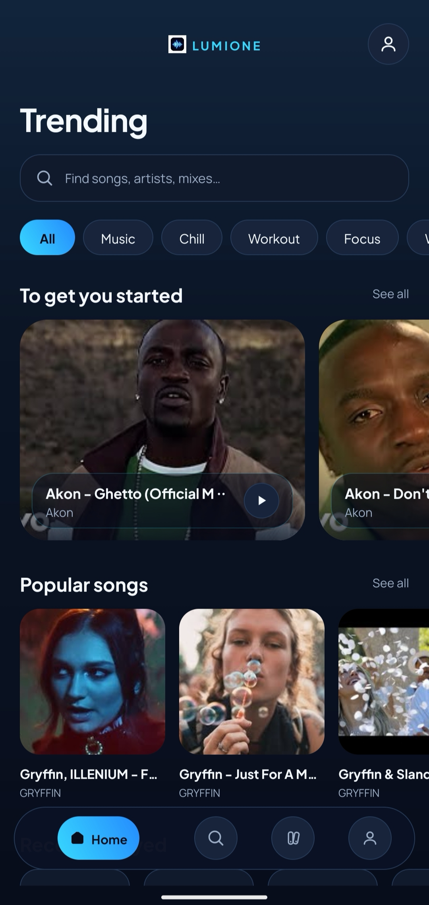
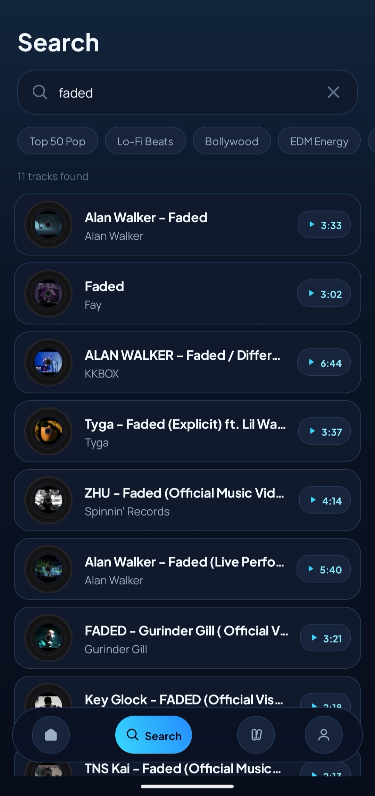
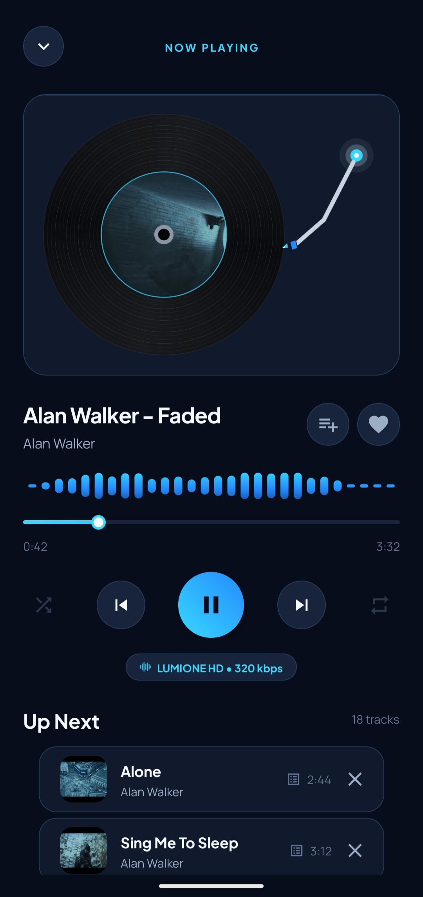

<div align="center">

# LumiOne

### Discover music. Build your library. Stay in the flow.

**A native Android music player with personalized discovery, a vinyl-inspired player, and a library built around your listening.**

[](https://developer.android.com/)
[](https://kotlinlang.org/)
[](https://github.com/d-ghosh717/LumiOne)
[](https://developer.android.com/about/versions/oreo)
[](https://nodejs.org/)

[Features](#features) · [Architecture](#architecture) · [Getting Started](#getting-started) · [Security](#security) · [Roadmap](#roadmap)

</div>

---

## About

LumiOne is a native Android music player built around music discovery and a focused listening experience. It combines a custom dark interface, a dedicated Media3 playback service, personal music collections, and recommendation features in one app.

The interface uses deep navy surfaces and cyan accents, with a vinyl-inspired Now Playing screen. Playback is designed to continue while the app is in the background, with Android media notification and lock-screen controls.

> **Release:** v1.2.0<br>
> **Package:** `com.lumione.player`<br>
> **Minimum Android version:** Android 8.0 (API 26)

## Screenshots

Add current screenshots to `docs/screenshots/` and update the filenames below. Keep screenshots current with the version in this README.

<div align="center">
<table>
  <tr>
    <td align="center"><strong>Home</strong><br/></td>
    <td align="center"><strong>Search</strong><br/></td>
    <td align="center"><strong>Now Playing</strong><br/></td>
  </tr>
</table>
</div>

## Features

| Area | What it does |
|---|---|
| **Music discovery** | Search for tracks and artists and explore configured discovery and chart sources. |
| **Playback** | Native audio playback powered by AndroidX Media3 / ExoPlayer. |
| **Background listening** | Playback service supports listening while the app is minimized or the screen is off. |
| **System media controls** | Playback controls through Android media notifications and supported lock-screen surfaces. |
| **Queue management** | View and manage the upcoming playback queue. |
| **Personal library** | Access favorites and listening history. |
| **Playlists** | Create and manage personal music collections. |
| **Google sign-in** | Firebase Authentication integration for supported account flows. |
| **Listening experience** | Custom dark UI, cyan accents, vinyl-inspired visuals, and animated player elements. |
| **Recommendation engine** | Seed-aware discovery and ranking, with alternate-version deduplication and listening signals as described in the project implementation. |

Availability of tracks, metadata, and playback streams depends on the configured providers, network availability, and each provider's terms.

## Technology stack

### Android client

- **Language:** Kotlin
- **UI:** Native Android views, XML layouts, and custom views
- **Playback:** AndroidX Media3 / ExoPlayer
- **Authentication:** Firebase Authentication and Google sign-in integration
- **Artwork loading:** Glide
- **Build:** Gradle and Android Gradle Plugin

### Backend services

- **Runtime:** Node.js
- **HTTP framework:** Express
- **Token verification:** Firebase Admin SDK
- **Hosting:** Render

| Service | Purpose |
|---|---|
| **Official LumiOne website** | [`https://lumione.onrender.com`](https://lumione.onrender.com) |
| **Android app backend API** | [`https://lumione-nextupdate.onrender.com`](https://lumione-nextupdate.onrender.com) |

**Important:** `https://lumione.onrender.com` is the official LumiOne web website where the web version will be hosted. It is not described here as the Android app's backend API. The Android app should use its dedicated backend at `https://lumione-nextupdate.onrender.com`.

Keep the website and Android API deployment configurations separate. Verify each service's repository branch, build/start commands, and environment variables before changing deployment settings.

The Android backend handles supported discovery and metadata API operations. Audio playback is handled by the Android client and its configured playback providers.

## Architecture

```text
┌──────────────────────────────────────┐
│           LumiOne Android            │
│                                      │
│ Home · Search · Library · Profile    │
│          Now Playing / Queue         │
└───────────────────┬──────────────────┘
                    │ HTTPS
                    │ Firebase ID token
                    ▼
┌──────────────────────────────────────┐
│     Android app backend API (Render) │
│  lumione-nextupdate.onrender.com     │
│                                      │
│ Authentication · Discovery · Metadata│
└───────────────────┬──────────────────┘
                    │
                    ▼
┌──────────────────────────────────────┐
│       Configured music sources       │
│       Charts · Track metadata        │
└──────────────────────────────────────┘

Android playback path
─────────────────────
Configured playback source
          ↓
Media3 / ExoPlayer
          ↓
PlaybackService
          ↓
Background audio + system controls
```

**Official website:** [`https://lumione.onrender.com`](https://lumione.onrender.com). This is the public LumiOne web-version URL. The web app's own API configuration should be documented separately if it uses a distinct backend service.

## Getting started

### Prerequisites

- Android Studio (a recent stable version)
- JDK 17
- Android SDK configured for the project
- Git
- Node.js and npm (only if running the backend locally)
- Firebase project configuration for the Android app

### 1. Clone the repository

```bash
git clone https://github.com/d-ghosh717/LumiOne.git
cd LumiOne
```

### 2. Configure Firebase

1. Open the project in Android Studio.
2. Configure the Android app in your Firebase project.
3. Place the app-specific `google-services.json` in the `app/` directory if required by the current Gradle setup.
4. Confirm that the intended authentication providers and Firestore rules are configured for the Firebase project.
5. Never commit service-account credentials, signing keys, passwords, or other private secrets.

Firebase configuration values intended for client apps are not a substitute for server-side authorization. Protect user data with Firebase security rules and verify authenticated ownership on every relevant data path.

### 3. Run tests

From the repository root:

```bash
./gradlew test
```

If Android instrumentation tests are configured and a device/emulator is available, run the appropriate `connectedAndroidTest` task as well.

### 4. Build the debug APK

```bash
./gradlew assembleDebug
```

Output:

```text
app/build/outputs/apk/debug/app-debug.apk
```

### 5. Build the release APK

```bash
./gradlew assembleRelease
```

Output:

```text
app/build/outputs/apk/release/app-release.apk
```

**Signing note:** A successful release build does not guarantee production-ready signing. Verify the APK signer before distribution. Do not distribute a debug-signed APK as a production release.

### 6. Run the backend locally (optional)

```bash
cd backend
npm install
npm start
```

Set the environment variables required by the current backend implementation before starting it. Do not put production secrets in source control or paste them into issue reports.

## Configuration

Review the actual environment and build configuration before changing endpoints or deployment settings.

- **Official web website:** `https://lumione.onrender.com`
- **Android API base URL:** `https://lumione-nextupdate.onrender.com`
- **Web API base URL:** configure according to the web app's actual API architecture; do not assume the official website URL is also an API endpoint.
- **Firebase:** use the intended project and verify authentication and database rules.
- Render: keep environment variables specific to each service.
- Local machine configuration and build artifacts should remain excluded from Git.

Do not assume the Android and web deployments share identical environment variables, build commands, or release cadence.

## Security

Security is an ongoing release requirement, not a one-time checklist.

- Use HTTPS for network requests.
- Never commit API secrets, service-account private keys, signing keystores, passwords, or tokens.
- Enforce authentication and user-level authorization on private data.
- Ensure Firestore rules restrict access to the authenticated user's own records.
- Do not use permissive rules such as `allow read, write: if true`.
- Review backend CORS settings against the actual web origins.
- Run dependency audits against the committed lockfile.
- Verify the release APK's signing certificate and checksum.
- Test sign-in, sign-out, playback, queue behavior, and cloud data access before release.

See [`SECURITY.md`](SECURITY.md) for the project's security audit report. Findings and deployment status should be re-verified against the current code and live services before relying on the report as release approval.

## Project structure

```text
LumiOne/
├── app/
│   └── src/
│       ├── main/
│       │   ├── java/com/lumione/player/
│       │   │   ├── auth/       # Authentication
│       │   │   ├── data/       # Library and persistence
│       │   │   ├── player/     # Playback providers and resolution
│       │   │   ├── queue/      # Queue models and behavior
│       │   │   ├── search/     # Search and discovery
│       │   │   ├── service/    # Media playback service
│       │   │   └── ui/         # Screens, adapters, custom views
│       │   └── res/            # Layouts, drawables, styles, resources
│       ├── test/               # Unit tests
│       └── androidTest/        # Instrumentation tests
├── backend/                    # Node.js / Express backend
├── release/                    # Release artifacts (if tracked locally)
├── firestore.rules             # Firestore rules (if present)
├── SECURITY_AUDIT.md           # Security review
├── build.gradle
├── settings.gradle
└── README.md
```

Actual directories may vary by branch; treat the checked-out repository as the source of truth.

## Roadmap

The following items are ideas for future development, not promises of a release date.

- [ ] Offline caching and downloaded playback, subject to provider rights and technical support
- [ ] Synchronized lyrics
- [ ] Audio equalizer and spatial-audio options
- [ ] Continued improvements to recommendations and listening personalization
- [ ] Further accessibility and playback-state polish

## Contributing

Bug reports and improvements are welcome. Before submitting a change:

1. Open an issue or describe the problem clearly.
2. Create a feature branch.
3. Keep changes focused and avoid committing secrets or generated artifacts.
4. Run relevant tests and build checks.
5. Submit a pull request with a summary, test evidence, and screenshots for UI changes.

Example:

```bash
git checkout -b feature/short-description
./gradlew test
git diff --check
```

## License

**All rights reserved.** Unless a separate license is added to this repository, the source code and project assets are not offered under an open-source license. Contact the repository owner for permission to reuse or redistribute them.

---

<div align="center">

**LumiOne v1.2.0**

*Built for a better listening experience.*

</div>
