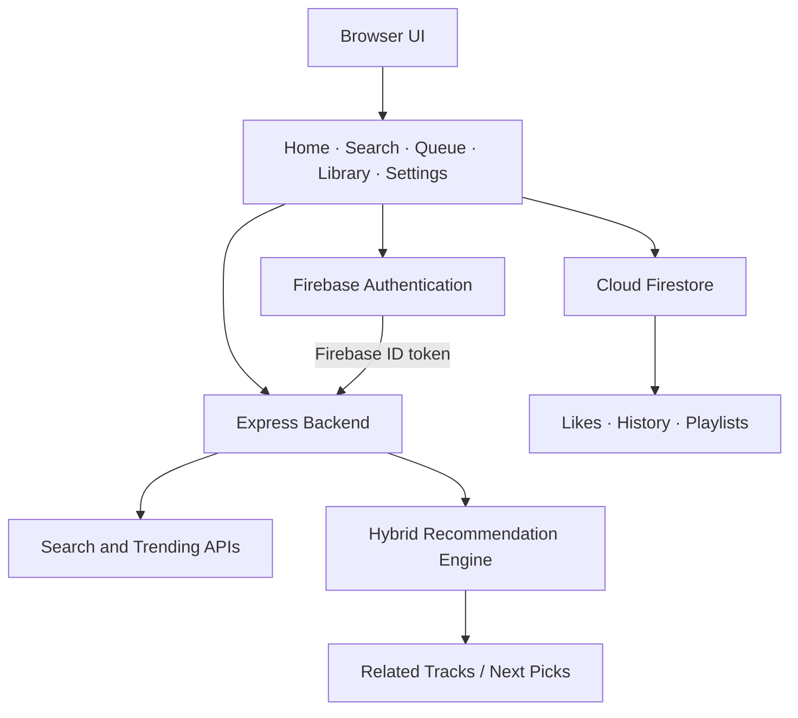

<div align="center">

# LumiOne — Web Player

**A quieter kind of music.**

A minimal, terminal-inspired music player for the web, built around discovery, playback, and a shared music library.

[**Open LumiOne**](https://lumione.onrender.com) · [Repository](https://github.com/d-ghosh717/LumiOne/tree/web)

</div>

---

## Overview

LumiOne Web is the browser companion to the LumiOne Android app. It uses a lightweight **HTML, CSS, and JavaScript** frontend served by the existing **Express** backend.

The interface keeps things deliberately minimal: a black canvas, cyan-blue accents, monospace typography, and no album-art clutter.

## Features

- **Music discovery** — search tracks and load trending results through the backend.
- **Playback controls** — play supported tracks with a usable YouTube video ID.
- **Queue** — manage upcoming tracks while keeping manually queued songs ahead of generated recommendations.
- **Related tracks** — recommendations use the existing hybrid recommendation engine shared with the Android app.
- **Personal library** — History, Liked Songs, and Playlists use the same Firebase user identity and Firestore data model as the mobile app.
- **Responsive UI** — desktop layout with a compact navigation experience for smaller screens.
- **Firebase authentication** — authenticated API requests send the Firebase ID token as `Authorization: Bearer <token>`.

> **Playback note:** a search result must include a usable YouTube video ID to be playable. Metadata-only results cannot start playback.

## Interface

The visual direction is intentionally restrained: pure black, white text, LumiOne cyan-blue, thin dividers, and compact monospace controls.

## Architecture



### Main components

| Path | Purpose |
| --- | --- |
| `index.html` | App shell, navigation, and script loading |
| `style.css` | Responsive black-and-cyan interface |
| `script.js` | Client-side navigation, player UI, and API integration |
| `firebase-config.js` | Local Firebase Web client configuration |
| `firebase-config.example.js` | Safe configuration template |
| `backend/server.js` | Express server, API routes, and authentication verification |
| `backend/recommender.js` | Recommendation and music-ranking logic |
| `backend/music_intelligence.js` | Music discovery and intelligence utilities |

## Run locally

**Requirements:** Node.js and npm.

From the repository root:

```bash
npm --prefix backend install
npm --prefix backend start
```

Then open [http://localhost:3000](http://localhost:3000).

The Express server serves the web client and its API from the same origin. Use the scripts already defined in `backend/package.json`.

## Firebase setup

1. Open the Firebase project used by LumiOne.
2. Enable the sign-in provider used by the app (Google sign-in, if configured).
3. Add `localhost` and your deployed hostname to **Firebase Authentication → Settings → Authorized domains**.
4. Configure the Firebase Web app values in the local `firebase-config.js`, using `firebase-config.example.js` as a template.
5. Ensure the existing Firestore security rules restrict users to their own data.

The Firebase Web configuration is client-side configuration and will be visible in the browser. **Never put service-account JSON, private keys, ID tokens, or other server secrets in frontend files or Git.** Restrict API keys appropriately in Google Cloud.

For production, set backend-only secrets through the hosting provider's environment configuration rather than committing them to the repository.

## Account sync and recommendation behavior

LumiOne Web uses the same Firebase user identity and Firestore collections as the Android app for:

- Liked songs
- Listening history
- Playlists

Data changes become visible across platforms when the other client refreshes or syncs its library. The playback queue and current playback position are **device-local**, not a shared cross-device queue. Shuffle and repeat defaults are browser-local.

The web recommendation flow uses the existing backend engine and account signals where supported. It keeps manual upcoming tracks ahead of generated recommendations and avoids recent or queued tracks when the current recommendation logic supports that behavior.

## Checks

Run the available checks from the repository root:

```bash
node --check script.js
npm --prefix backend test
```

There is no separate web build command for this static frontend. A successful syntax check does not replace testing sign-in, API connectivity, and real playback in a browser.

## Deployment

The production website is:

**https://lumione.onrender.com**

The current Express server serves the static web client and API from the same service. Confirm the Render service uses the intended GitHub repository and `web` branch, and configure any required backend environment variables in Render. Do not commit production secrets.

After deployment, verify sign-in, search, trending playback, queue actions, and library access on the live domain.

## Project principles

- Keep the interface image-free except for the LumiOne brand mark.
- Keep the black, white, and cyan-blue palette.
- Reuse the mobile app's backend and recommendation logic rather than duplicating it.
- Do not use mock data to disguise missing backend functionality.
- Keep credentials and private configuration out of source control.

---

<div align="center">

**crafted with ♥ and caffeine**

</div>
